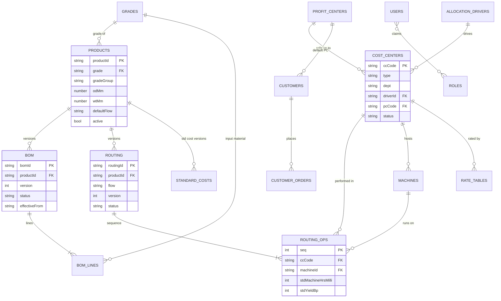
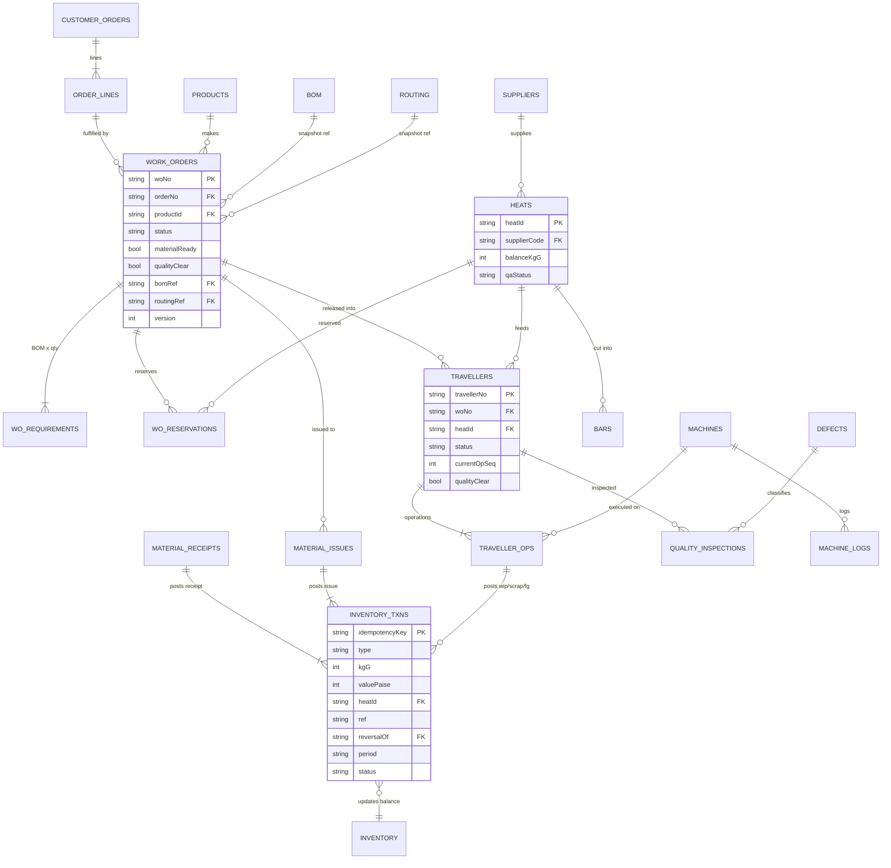
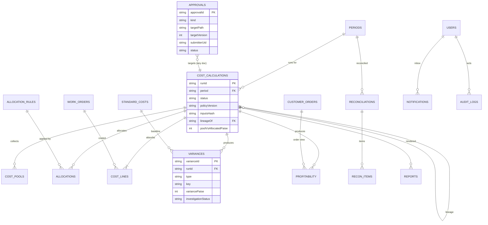

# Deliverable 4 — Firestore Architecture & ER Design

Builds on `docs/DATA_MODEL.md` (tenancy path, append-only ledger, Functions-only financial writes) and `firebase/firestore.rules`. Names follow the collection list you specified. Collections that the business flow needs but that weren't on the list are marked **(added)**.

## 1. Design principles

1. **Tenancy path (existing convention, kept):** `tenants/{tenantId}/companies/{companyId}/plants/{plantId}/…`. Shared masters sit at company level. Transactions and cost results sit at plant level. Every plant-scoped document also stores `plantId`, which collection-group queries need.
2. **All business writes go through Cloud Functions.** Clients read under rules and never write business documents. This extends today's rule (ledger, approvals, periods, costRuns) to every collection, so validation, state machines, maker-checker and period locks run in one trusted place.
3. **Masters are versioned and effective-dated.** Approved versions are immutable. Transactions store the **version they used** (snapshot reference), so a later master change never alters history.
4. **Posted records are immutable.** Inventory transactions, inspections, cost runs and audit logs are never updated or deleted. Corrections are made by reversal or supersession (INV-03, COST-02).
5. **Deterministic numbers (COST-01).** Money is stored as integer **paise** (`…Paise`). Quantities are stored as integers in base units (`kgG` = grams, `qty` = pieces, `hrsMilli` = milli-hours). Rates are stored as exact decimal strings (`"1234.5678"`) and evaluated with decimal.js. Line results are rounded half-up to paise (COST-03 pending client confirmation).
6. **No unbounded arrays, no document over 1 MB.** Line items go in subcollections (BOM lines, routing ops, traveller operations, cost lines).
7. **Audit metadata on every document:** `createdBy, createdAt, updatedBy, updatedAt, version` (the existing `AuditMeta` type). `version` drives the APR-02 stale-approval guard.

## 2. Collection map

### Tenant level — `tenants/{t}/…`

| Collection | Doc ID | Purpose |
|---|---|---|
| `users` | `{uid}` | Profile, `roles[]`, `plantIds[]`, `active`. Mirrors the custom claims; the Function is the source of truth for claims. Subcollection `notifications/{id}`. |
| `roles` | `{roleId}` | Role catalogue (15 technical roles → persona, description, `assignableBy`). Read-only reference. |
| `auditLogs` | auto | Append-only: `actorUid, action, entity, entityPath, before, after, reason, at, plantId`. **Moved from root** (today's rules use root `auditLogs`, which is not tenant-isolated). |

### Company level — `tenants/{t}/companies/{c}/…`

| Collection | Doc ID | Key fields | References |
|---|---|---|---|
| `products` | `{productId}` | grade, gradeGroup, odMm, wtMm, lengthMm, productType, cta, hsn, baseUom, defaultFlow (HF/CF/UB), active | `grades/{grade}` |
| `grades` **(added)** | `{grade}` | gradeGroup, densityKgPerM3, specRef, active | — |
| `customers` | `{customerCode}` | name, group, erpRef, defaultProfitCenter, active | `profitCenters` |
| `suppliers` | `{supplierCode}` | name, approvedVendor, origin, erpRef, active | — |
| `profitCenters` | `{pcCode}` | desc, entity (8911), interimAllowed (514), active | — |
| `uoms` **(added)** | `{uom}` | dimension (mass/length/count/time/energy), conversions[] | — |
| `defects` **(added)** | `{defectCode}` | category, detectingTest (ECT/hydro/DPT/visual/dim), defaultDisposition, coqClass | — |
| `allocationDrivers` **(added)** | `{driverId}` | pool (§15.2), primaryDriver, secondaryDriver, driverUom, quantitySource | — |
| `customerOrders` **(added)** | `{orderNo}` | customerCode, orderDate, currency (INR), erpRef, status. Subcollection `lines/{lineNo}`: productId, qty, kgG, pricePaise, dueDate | `customers`, `products` |

### Plant level — `tenants/{t}/companies/{c}/plants/{p}/…`

**Masters**

| Collection | Doc ID | Key fields | Subcollections | References |
|---|---|---|---|---|
| `costCenters` | `{ccCode}` (8204…) | desc, dept, flow, type (production/service/project/reporting), owner, driverId, uom, capacityBasis, pcCode, glElements[], effectiveFrom/To, status, active | — | `profitCenters`, `allocationDrivers` |
| `machines` | `{machineId}` | ccCode, assetId, installedHrs, practicalHrs (CAS-2), meters[] (≤10), active | — | `costCenters` |
| `bom` | `{productId}__v{n}` | productId, version, status (Draft/PendingApproval/Approved/Superseded), effectiveFrom/To, outputKgG | `lines/{lineNo}`: materialGrade, inputKgGPerOutputKg, scrapFactor, recoveryPaisePerKg | `products`, `grades` |
| `routing` | `{productOrGroup}__{flow}__v{n}` | productId or gradeGroup, flow, version, status, effectiveFrom/To | `ops/{seq}`: process, ccCode, machineId, stdMachineHrsMilli, stdLabourHrsMilli, stdYieldBp, inspectionGate | `costCenters`, `machines` |
| `rateTables` **(added)** | `{type}__{ccCode}__v{n}` (type = machine/labour/utility/overhead) | rate (decimal string), uom, basis, effectiveFrom/To, status, sourceRunId | — | `costCenters` |
| `standardCosts` **(added)** | `{productId}__v{n}` | element breakdown in paise/kg (Annex A lines), bomRef, routingRef, rateVersions{} | — | `bom`, `routing`, `rateTables` |
| `allocationRules` **(added)** | `{ruleId}` | sourceCc, pool, targets[] (≤50) or driver-based, sequence, method (direct/step-down), effectiveFrom | — | `costCenters`, `allocationDrivers` |

**Production & inventory transactions**

| Collection | Doc ID | Key fields | Subcollections | References |
|---|---|---|---|---|
| `workOrders` | `{woNo}` | orderNo, orderLineNo, productId, plannedQty, plannedKgG, uom, status (`WorkOrderStatus`), materialReady, qualityClear, holdReason, bomRef + bomVersion, routingRef + routingVersion, plannedStart, dueDate, period | `requirements/{lineNo}` (BOM snapshot × qty), `reservations/{id}` (heatId, kgG) | `customerOrders`, `products`, `bom`, `routing` |
| `travellers` | `{travellerNo}` | woNo, heatId, barIds[] (≤20), flow, pass, status (Created/InProgress/AtInspection/OnHold/Rework/Completed/Closed), currentOpSeq, inputQty/KgG, goodQty/KgG, qualityClear | `operations/{seq}`: ccCode, machineId, operatorUid, startedAt, endedAt, inputKgG, outputKgG, scrapKgG, reworkQty, machineHrsMilli, labourHrsMilli, status, std snapshot | `workOrders`, `heats`, `machines`, `costCenters` |
| `heats` **(added)** | `{heatId}` | materialGrade, supplierCode, millCertRef, receivedKgG, balanceKgG, qaStatus (Hold/Released/Rejected) | `bars/{barId}`: lengthMm, kgG, status | `suppliers`, `grades` |
| `inventory` | `{locationId}__{itemKey}` | location (RM/WIP/FG/QA-HOLD/SCRAP), locationType, itemType (heat/bar/product), heatId, productId, woNo, qty, kgG, valuePaise, lastTxnId | — | `heats`, `products`, `workOrders` |
| `inventoryTxns` **(added — the ledger)** | `{idempotencyKey}` | type (receipt/issue/return/transfer/adjust/wip/fg/**scrap**), qty, kgG, valuePaise, locationFrom/To, heatId, barId, ref (WO/traveller/GRN/order), sourceDoc path, reversalOf, period, status (`MovementStatus`), postedAt, postedBy | — | `heats`, `workOrders`, `travellers`, `materialIssues` |
| `materialIssues` | `{issueNo}` | woNo, status (Draft/PendingApproval/Posted/Reversed), excessOverBom, approvalId, period | `lines/{n}`: heatId, barId, kgG, txnId | `workOrders`, `heats`, `inventoryTxns` |
| `materialReceipts` **(added)** | `{grnNo}` | supplierCode, poRef, status, period | `lines/{n}`: heatId, grade, kgG, landedValuePaise, txnId | `suppliers`, `heats` |
| `qualityInspections` | auto | travellerNo, woNo, opSeq, testType (visual/dim/hydro/ect/dpt/final), parameters{}, result (Pass/Fail), defects[] (≤20: defectCode, qty), disposition (Accept/Rework/Reject/Hold), inspectorUid, releasedBy, certRef (EN 10204 3.2) | — | `travellers`, `defects` |
| `machineLogs` **(added)** | `{machineId}__{yyyymmdd}__{shift}` | runHrsMilli, idleHrsMilli, changeoverHrsMilli, breakdownMechHrsMilli, breakdownElecHrsMilli, reasonCodes[], meterReadings{} | — | `machines` |

**Costing, control & reporting**

| Collection | Doc ID | Key fields | Subcollections | References |
|---|---|---|---|---|
| `periods` **(added)** | `{yyyymm}` | locked, lockedBy/At, reopenApprovalId, closeSteps{ "D+1–D+2": {status, owner, signedBy, at} }, annexB{} | — | — |
| `costPools` **(added)** | `{runId}__{ccCode}__{element}` | collectedPaise, allocatedInPaise, allocatedOutPaise, absorbedPaise, sourceRefs (GL extract id) | — | `costCalculations`, `costCenters` |
| `allocations` | `{runId}__{ruleId}__{targetCc}` | sourceCc, targetCc, pool, driverQty, sharePaise, step | — | `costCalculations`, `allocationRules` |
| `costCalculations` | `{runId}` | period, scope (plant/flow/WO list), status (`CostingStatus`), policyVersion, rateVersions{}, inputsHash, lineageOf (previous runId), gate {poolVsAllocatedPaise must equal 0}, totals{}, submittedBy, approvedBy, finalizedBy | `lines/{woNo}__{element}`: woNo, productId, element, amountPaise, qtyBasis, rate, sourceRef | `periods` |
| `variances` | `{runId}__{type}__{key}` | type (MPV/MUV/yield/labourRate/labourEff/machineSpend/machineEff/capacity/utility/quality/scrap), key (ccCode/productId/heatId/woNo), stdPaise, actualPaise, variancePaise (+ = favourable), investigation {rootCause, action, ownerUid, due, status} | — | `costCalculations` |
| `profitability` | `{runId}__{dimension}__{key}` | dimension (product/customer/order/pc/flow/gradeGroup), nsrPaise, rmPaise, conversionPaise, qualityPaise, packingPaise, sdPaise, contributionPaise, marginBp | — | `costCalculations`, `customerOrders` |
| `reconciliations` **(added)** | `{period}__{type}` | type (sopic/pc/gl/heat/dispatch), status (`ReconStatus`), summary{} | `items/{id}`: kind (invoice0/pc/dispatch/…), ref, amountPaise, ownerUid, due, status | `periods` |
| `approvals` | `{approvalId}` | kind (see matrix §4), targetPath, targetVersion, submitterUid, status (`ApprovalStatus`), assigneeRoles[], decidedBy, reason, slaDue | `thread/{id}` comments | any target document |
| `exceptions` **(added)** | `{id}` | kind, ref path, severity, ownerUid, due, status | `thread/{id}` | any |
| `kpiSnapshots` **(added)** | `{period}` or `{yyyymmdd}` | §23 KPI values, computed by scheduled Function | — | — |
| `coqSnapshots` **(added)** | `{runId}__{key}` | CoQ by class (prevention / appraisal / internal failure / external failure) per flow / product / CC, in paise | — | `costCalculations` |
| `inventoryValuations` **(added)** | `{period}__{locationType}` | RM / WIP / FG value at period end, method, NRV adjustment, ageing bands 30/60/90, runId | `items/{key}` | `costCalculations`, `inventory` |
| `reports` | `{reportId}` | type (RPT-01…06), params, period, runId, status (Queued/Ready/Failed), storagePath (Cloud Storage), requestedBy, expiresAt | — | `costCalculations` |
| `events` **(added — outbox)** | auto | name (`workOrder.released`, `movement.posted`, …), entityPath, payload, at, dispatched (bool) | — | any. Written in the same transaction as the business change; a trigger fans out to notifications, KPI refresh and ERP sync |

## 3. ER diagrams

### 3.1 Masters



### 3.2 Production & inventory



### 3.3 Costing, control & governance



## 4. Parent–child structure (subcollections)

```
companies/{c}
  customerOrders/{orderNo}/lines/{lineNo}
plants/{p}
  bom/{bomId}/lines/{lineNo}
  routing/{routingId}/ops/{seq}
  workOrders/{woNo}/requirements/{lineNo}
  workOrders/{woNo}/reservations/{id}
  travellers/{travellerNo}/operations/{seq}
  heats/{heatId}/bars/{barId}
  materialIssues/{issueNo}/lines/{n}
  materialReceipts/{grnNo}/lines/{n}
  costCalculations/{runId}/lines/{woNo}__{element}
  reconciliations/{period}__{type}/items/{id}
  approvals/{id}/thread/{id}
  exceptions/{id}/thread/{id}
tenants/{t}
  users/{uid}/notifications/{id}
```

Rule of thumb: a child goes into a **subcollection** when it can grow without limit or is written independently (ops, cost lines, txns). It stays an **embedded array** only when it is bounded and written with its parent (defects ≤ 20, meters ≤ 10).

## 5. Indexes required (`firebase/firestore.indexes.json` — new file)

Single-field indexes are automatic. These composite indexes come from the screen queries in `01-screen-inventory.md`. **CG** = collection-group index.

| Collection | Fields (order) | Serves |
|---|---|---|
| `workOrders` | `status` ASC, `plannedStart` DESC | PRD-01, DSH-02 |
| `workOrders` | `productId` ASC, `status` ASC | PRD-01 filter, MST-01 where-used |
| `workOrders` | `orderNo` ASC, `orderLineNo` ASC | PRF-03, order → WO |
| `workOrders` | `period` ASC, `status` ASC | close D+1, CST-02 scope |
| `travellers` | `woNo` ASC, `pass` ASC | PRD-02 |
| `travellers` | `status` ASC, `currentOpSeq` ASC | PRD-04, PRD-06 queue |
| `travellers` | `heatId` ASC, `createdAt` ASC | INV-07 genealogy |
| `operations` (CG) | `plantId` ASC, `ccCode` ASC, `endedAt` DESC | PRD-08, cost absorption |
| `operations` (CG) | `plantId` ASC, `machineId` ASC, `startedAt` DESC | PRD-07, utilization |
| `inventoryTxns` | `heatId` ASC, `postedAt` ASC | INV-07 |
| `inventoryTxns` | `period` ASC, `type` ASC, `postedAt` ASC | RPT-02, close D+3 |
| `inventoryTxns` | `ref` ASC, `postedAt` ASC | WO / traveller movements |
| `inventory` | `locationType` ASC, `kgG` DESC | INV-01/02/03 |
| `inventory` | `woNo` ASC, `locationType` ASC | WIP by WO |
| `materialIssues` | `woNo` ASC, `status` ASC | PRD-02, INV-04 |
| `qualityInspections` | `travellerNo` ASC, `opSeq` ASC | PRD-05 |
| `qualityInspections` | `testType` ASC, `createdAt` DESC | QUA-02/03/04 |
| `qualityInspections` | `disposition` ASC, `createdAt` DESC | QUA-05, QUA-06 |
| `machineLogs` | `machineId` ASC, `date` DESC | PRD-07 |
| `costCalculations` | `period` ASC, `status` ASC, `createdAt` DESC | CST-02, CST-05 |
| `lines` (CG, cost lines) | `plantId` ASC, `woNo` ASC | PRD-02 cost to date, RPT-01 |
| `variances` | `runId` ASC, `type` ASC, `variancePaise` ASC | VAR-02…07 (largest adverse first) |
| `variances` | `investigation.ownerUid` ASC, `investigation.status` ASC | owner worklist |
| `profitability` | `runId` ASC, `dimension` ASC, `marginBp` ASC | PRF-01…04 |
| `approvals` | `status` ASC, `assigneeRoles` CONTAINS, `createdAt` ASC | APR-01 |
| `approvals` | `submitterUid` ASC, `createdAt` DESC | own submissions |
| `approvals` | `status` ASC, `kind` ASC, `decidedAt` DESC | APR-03 |
| `items` (CG, recon) | `plantId` ASC, `status` ASC, `due` ASC | FIN-03 |
| `exceptions` | `status` ASC, `severity` DESC, `due` ASC | SUP-01 |
| `notifications` (CG) | `uid` ASC, `read` ASC, `createdAt` DESC | SUP-02 |
| `auditLogs` | `entityPath` ASC, `at` DESC | record history |
| `auditLogs` | `actorUid` ASC, `at` DESC | SUP-04 |

## 6. Write ownership (Functions) and read rules

| Collection(s) | Written by (callable / trigger) | Client read rule (persona, from the matrix) |
|---|---|---|
| masters (`products`, `costCenters`, `bom`, `routing`, …) | `saveMasterDraft`, `submitMasterVersion`, `approveMasterVersion` (on decision) | all plant users read `Approved`. Drafts: owner persona + checker |
| `workOrders` + subs | `createWorkOrder`, `transitionWorkOrder`, `reserveMaterial` | matrix PRD-01/02 (operator: assigned WOs only) |
| `travellers` + `operations` | `releaseWorkOrder` (generates), `recordOperation`, `createRework` | matrix PRD-04/05 |
| `inventoryTxns`, `inventory`, `heats` | `postLedgerTxn` (existing, extended), `postReceipt`, `postMaterialIssue` — one transaction updates txn + balance + heat | SCM, CST, FIN, PRD (WIP), QUA (heats) |
| `qualityInspections` | `recordInspection`, `releaseQuality` | QUA, PRD, CST |
| `costPools`, `allocations`, `costCalculations`, `variances`, `profitability` | `runCostCalculation` (long-running, 2nd gen), `transitionCosting` | CST, FIN, MGT (variance owners read their keys) |
| `approvals` | `submitForApproval`, `decideApproval` (existing, extended) | assignee roles + submitter |
| `periods` | `signCloseStep`, `lockPeriod` (existing), `requestReopen` | all signed-in (lock status), FIN detail |
| `reconciliations` | `runReconciliation`, `transitionRecon` | FIN, CST |
| `auditLogs` | every Function (same transaction where possible) | FIN, CST, MGT, ADM, auditor |
| `kpiSnapshots` | scheduled `computeKpis` (hourly + on run finalize) | per dashboard matrix |
| `reports` | `generateReport` → Cloud Storage | per report matrix |
| `users/{uid}/notifications` | event triggers. Client may update **only** `read: true` on own docs | owner |

## 7. Inconsistencies found in the current Firebase code

| # | Finding | Impact | Resolution |
|---|---|---|---|
| F-1 | Functions write `tenants/main/ledger`, `tenants/main/heats`, `tenants/main/approvals`, `tenants/main/periods`, while `DATA_MODEL.md` and the rules use `tenants/{t}/companies/{c}/plants/{p}/…` | Data written outside the plant scope is unreadable under current rules and breaks plant isolation | Central path helper `paths.ts` (shared) used by Functions and repositories |
| F-2 | Ledger collection is named `ledger` in Functions and `inventoryTxns` in DATA_MODEL | Two names for one ledger | Standardize on `inventoryTxns` |
| F-3 | `auditLogs` at the database root | Not tenant-isolated | Move under `tenants/{t}/auditLogs` |
| F-4 | `TxnType` has no `scrap` type; rejects can only be posted as `adjust` (which requires approval) | Normal process scrap would flood the approval queue | Add `scrap` type, posted by `recordOperation` / `recordInspection` |
| F-5 | No `firestore.indexes.json` | Composite queries fail in production | Add the file from §5 |
| F-6 | `postLedgerTxn` heat balance stored as `kg` (float) | Float drift breaks COST-01 determinism | Integer grams (`balanceKgG`) |
