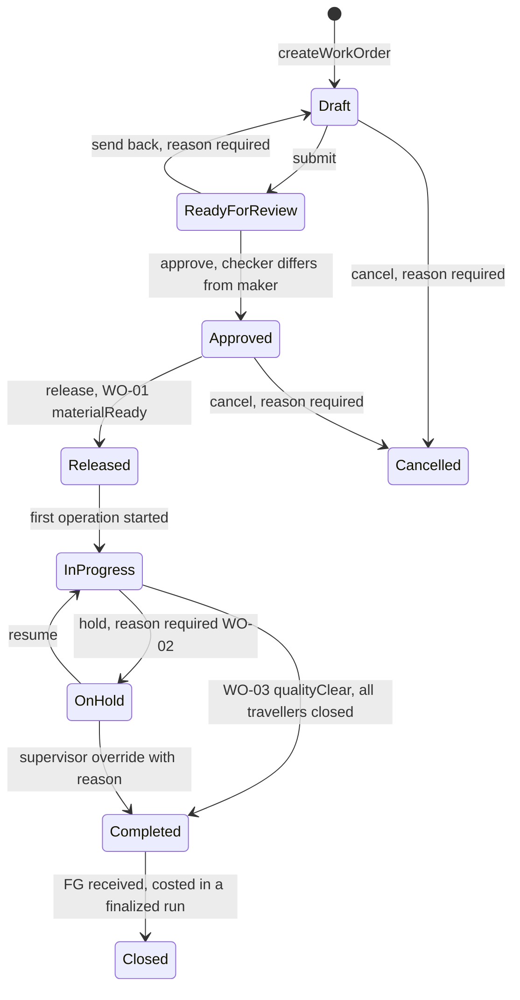
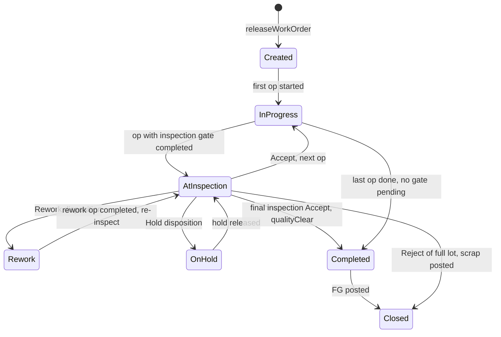
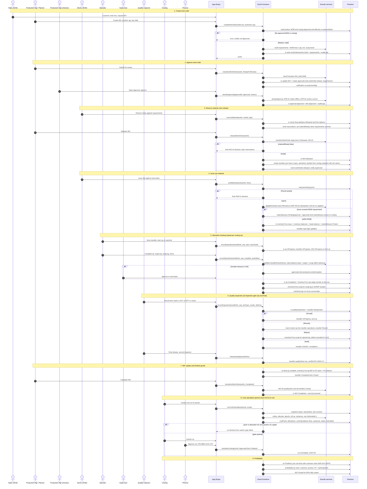

# Deliverable 5 — Production Module Sequence Flow

End-to-end flow: **Create WO → Approve → Release → Issue RM → Traveller → Operations → Quality → WIP → FG → Cost Calculation → Profitability**.

Every state change goes through a Cloud Function that calls the shared domain service (`src/domain/services.ts`). That service checks the transition against the state machine (`checkTransition`), applies the business rules (WO-01/02/03, INV-01/02/03, PER-01, APR-01/02) and returns audit events. The Function then commits the record, ledger and audit entries in **one Firestore transaction**.

## 1. State machines involved

### Work order — proposed change to `WO_MACHINE`

You asked for a separate **Approve** step before Release. The existing machine goes straight from `ReadyForReview` to `Released`. The proposal adds an `Approved` state so that approval (maker-checker) and release (material readiness, WO-01) are separate gates.

Code impact: add `'Approved' | 'Cancelled'` to `WorkOrderStatus`, add the edges to `WO_MACHINE`, update `phase3.test.ts`. **Needs D-05 confirmation.**

### Traveller — new `TRAVELLER_MACHINE`

## 2. Detailed interaction diagram

## 3. Step → data → rule summary

| # | Step | Function | Writes | Rules / gates |
|---|---|---|---|---|
| 1 | Create WO | `createWorkOrder` | `workOrders` (Draft), `requirements` | Approved, effective BOM + routing |
| 2 | Approve | `transitionWorkOrder`, `decideApproval` | `approvals`, WO → Approved | APR-01, APR-02, WO_MACHINE |
| 3 | Release | `reserveMaterial`, `releaseWorkOrder` | `reservations`, WO → Released, `travellers` + `operations` | WO-01, heat QA released |
| 4 | Issue RM | `postMaterialIssue` | `materialIssues`, `inventoryTxns` (issue), `inventory`, `heats` | INV-01, INV-02, PER-01, excess → approval |
| 5 | Operations | `recordOperation` | `operations`, `inventoryTxns` (wip, scrap), `machineLogs` | mass balance, D-06 tolerance, supervisor approval |
| 6 | Quality | `recordInspection`, `releaseQuality`, `createRework` | `qualityInspections`, traveller status, scrap txns | disposition rules, two-person release |
| 7 | WIP → FG | (inside `recordOperation` final op), `transitionWorkOrder` | `inventoryTxns` (fg), WO → Completed | WO-03 |
| 8 | Cost calc | `runCostCalculation`, `transitionCosting` | `costPools`, `allocations`, `costCalculations`, `variances` | COST-01/02/03, §15.3 gate, COSTING_MACHINE |
| 9 | Profitability | trigger on run Finalized | `profitability`, `kpiSnapshots`, WO → Closed | uses finalized runs only |

## 4. Events (in-process today, per `INTEGRATION_CONTRACTS.md`)

`workOrder.created`, `workOrder.approved`, `workOrder.released`, `movement.posted`, `operation.completed`, `inspection.recorded`, `quality.released`, `fg.received`, `costing.calculated`, `costing.finalized`, `approval.decided`, `recon.resolved`, `period.locked`.

Each event drives notifications, KPI snapshot refresh, and (later) ERP outbound sync. Events are written in the same transaction as the business change, as documents in `events/{id}` (outbox pattern), so retries never lose or duplicate them.

## 5. Open points that block exact implementation

| Ref | Question | Affects step |
|---|---|---|
| D-05 | Confirm the Approve stage and the cancel policy for released WOs | 1–3 |
| D-06 | Mass-balance tolerance per op and inspection gates per routing op | 5–6 |
| D-07 | Traveller granularity: one per heat, per bar bundle, or per pilger pass? | 3, 5 |
| D-08 | Is WIP transferred per op at standard (proposed) or only at FG? | 5, 7 |
| D-09 | Rework cost treatment: absorbed into product or charged to CoQ (internal failure)? | 6, 8 |
| INV-02 | Is negative WIP ever allowed (backflush)? | 4, 5 |
