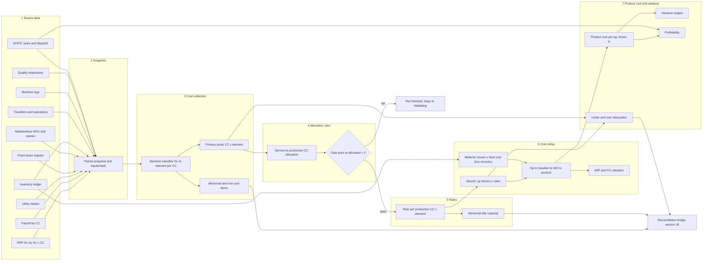
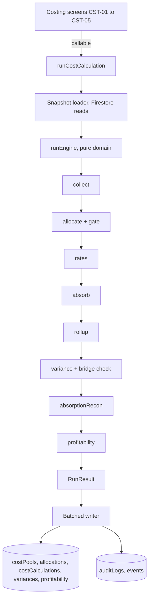

# Deliverable 6 — Cost Engine Architecture

Flow: **Source Data → Cost Collection → Allocation Rules → Cost Rollup → Product Cost → Variance Analysis** (then profitability and close).

> All formulas below are **candidate** formulas aligned to manual AIPL-CAM-001 and the Indian CAS framework (the manual's §2 lists CAS references). They are **not approved accounting rules** until Finance signs off D-10 (formulas), D-11 (UOM / rounding / currency) and D-09 (scrap / rework treatment). This matches the warning already in `src/lib/costing.ts`.

## 1. Cost element catalogue

Each element keeps its identity from collection through to the product cost line, so every rupee in a product cost can be traced back to its source and analysed for variance.

| # | Element | Source data | Collected at | Allocation (§15) | Absorption basis into product | Annex A line | Product cost? | Inventory value? | CAS ref* |
|---|---|---|---|---|---|---|---|---|---|
| 1 | **Material** | Inventory ledger issues (heat landed cost), BOM | Direct to WO / traveller | — (direct) | Actual kg issued to traveller × heat cost; less scrap recovery | Raw Material | Yes | Yes | CAS-6 |
| 2 | **Labour** | Payroll by CC (HR), attendance, op labour hours | Production & service CCs | Service CC labour → production CCs | Op labour hrs × CC labour rate. Abnormal idle excluded (§8.4) | Direct Labour | Yes | Yes | CAS-7 |
| 3 | **Machine** | GL machine-related costs by CC, machine logs | Production CC (machine pool, §9.2) | — | Op machine hrs × MHR (pool ÷ practical hrs, CAS-2) | Machine Cost | Yes | Yes | CAS-2, CAS-3 |
| 4 | **Utility** | Meters per CC (power, gas, water, compressed air, process gases) | Measured CC; common utilities pool | Common utility pool → CCs by measured usage / technical norm (§10) | Op machine hrs × utility rate, or metered per op | Machine Cost (utility sub-line) | Yes | Yes | CAS-8 |
| 5 | **Quality** | Testing CCs (ECT 820410335, hydro 820410354, lab), inspections, rework / reject | Testing CCs + CoQ classification | Lab / QA service CC → production CCs | Inspection-op hrs × rate. Rework ops absorbed. Reject cost per D-09 | Quality / Testing | Yes | Yes | CAS-21 |
| 6 | **Packing** | Packing material issues, packing CC (820410308, 820410273) | Direct (primary) + packing CC | — | Primary packing direct per WO; packing op hrs × rate | Primary Packing | Primary: yes. Secondary: S&D | Primary only | CAS-9 |
| 7 | **Overhead** (production) | GL: supervision, insurance, factory common (§16.4) | Production / service CCs | Per `OVERHEAD_MATRIX` drivers | Labour or machine hrs × OH rate | Production Overheads | Yes | Yes | CAS-3 |
| 8 | **Admin** | GL admin CCs (Finance dept 11 CCs, HR, IT…) | Admin / reporting CCs | Not allocated to production | **Period cost.** Applied to profitability only, as an approved % on sales (§16 "%-on-sales discipline") | — (below Total Cost of Sales) | No | No | CAS-11 |
| 9 | **SCM** | Procurement, stores, logistics CCs, freight GL | SCM CCs | Inbound → material landed cost. Stores → production OH. Outbound → S&D | Inbound: in heat cost. Stores: OH rate. Outbound: per order dispatch | RM (inbound) / Prod OH / S&D | Inbound + stores: yes. Outbound: no | Inbound + stores | CAS-6, CAS-15 |
| 10 | **Finance cost** | Interest, bank charges GL | Corporate / reporting CC | Not allocated | **Excluded from product cost.** Shown in PC profitability and the §18 financial bridge | — | No | No | CAS-17 |
| 11 | **Depreciation** | Fixed-asset register (costing depreciation) | Asset's CC | Service-asset depreciation → production CCs | Production assets: inside MHR pool (§9.2) | Machine Cost / Prod OH | Yes | Yes | CAS-16 |
| 12 | **Maintenance** | Maintenance WOs, spares issues, contractor GL | Machine CC where traceable; else maintenance service CC | Maintenance CC → production CCs by maintenance hrs (§15.2 driver) | Inside MHR pool | Machine Cost | Yes | Yes | CAS-12, CAS-13 |

\* Verify CAS references against the manual's §2 table (`CAS_LIST` in `src/mocks/manual.ts`); the law prevails over this summary.

**Non-cost / abnormal items** (§17.5 `ABNORMAL_ITEMS`) such as penalties, abnormal wastage, abnormal idle capacity and prior-period errors are tagged `abnormal=true` at collection. They never enter product cost and go straight to the reconciliation bridge.

## 2. Pipeline



## 3. Stage specifications

### Stage 1 — Source data (adapters)

| Source | Adapter (D-16: live vs import) | Snapshot content | Completeness check |
|---|---|---|---|
| ERP GL (SAP) | `glExtract` import / API | GL lines: account, CC, amount (paise), period | Σ GL production + service CCs = trial balance cost total |
| Payroll (HR) | `payrollExtract` (D-17) | CC × employee-class cost, hours | Every active production CC has labour cost or an explicit zero |
| Meters | manual reading / SCADA import | Meter × CC × unit consumption | All meters on `machines.meters` have a reading |
| Fixed assets | `faExtract` | Asset × CC × costing depreciation | Σ = GL depreciation (or reconciled difference) |
| Maintenance | maintenance WO import | WO × machine / CC × cost, hours | — |
| Inventory ledger | internal (`inventoryTxns`) | Issues, scrap, receipts, FG for the period | Heat reconciliation D+3 signed off |
| Travellers / ops | internal | Completed ops with hours and kg | No traveller op left `InProgress` across the cut-off without a WIP flag |
| Machine logs | internal | Run / idle / breakdown hours | Σ op machine hrs ≤ machine run hrs |
| Quality | internal | Inspections, dispositions, rework | All `AtInspection` items dispositioned or flagged WIP |
| SOPIC | `sopicExtract` | Invoice lines: order, customer, product, NSR, PC | `reconcileSopic` run: Invoice-0 and unknown PCs resolved or accepted |

The snapshot is frozen. `inputsHash = sha256(canonicalJSON(snapshot))`. Recalculating on the same snapshot with the same `policyVersion` must reproduce byte-identical results (COST-01).

### Stage 2 — Cost collection

```
for each GL line (account, cc, amount):
    element  = elementMap[account]            // versioned mapping, Finance-approved
    abnormal = abnormalMap[account] ?? false
    pool[cc][element] += amount               // integer paise
```

Output: `costPools/{runId}__{cc}__{element}.collectedPaise`. Unmapped accounts are a **blocking validation error**; they are never silently pooled.

### Stage 3 — Allocation rules (§15)

- **Order:** service CCs are allocated in `allocationRules.sequence` order. Step-down is proposed (D-10): once a service CC has been allocated, it receives nothing back. Reciprocal allocation is a later option.
- **Share:** `share(target) = pool(source, element) × driverQty(target) ÷ Σ driverQty(all targets)`. Driver quantities come from the snapshot (machine hrs, kWh, headcount, floor area, maintenance hrs) per `allocationDrivers`.
- **Rounding:** each share is rounded half-up to paise, and the **largest-remainder** residual goes to the target with the largest driver. This keeps the allocated total exactly equal to the source pool.
- **Gate (§15.3):** `Σ collected(all CCs) − Σ (production CC pools after allocation) − Σ (non-allocated admin / finance / abnormal) = 0`. If the gate fails, the run cannot move from `Validating` to `ReadyForCalculation`. The demo already simulates this as the ₹250 imbalance in `costing.tsx`.

### Stage 4 — Rates

For each production CC `c` and element `e`:

| Rate | Candidate formula | Notes |
|---|---|---|
| Machine-hour rate | `MHR(c,e) = pool(c,e) ÷ practicalHrs(c)` | Practical capacity (CAS-2), **not** actual hours, so idle capacity is not loaded onto products. Reuses `machineHourRate()` from `lib/costing.ts` |
| Labour rate | `LR(c) = labourPool(c) ÷ (practical labour hrs(c))` | Normal idle inside the rate. Abnormal idle is separated (§8.4) |
| Utility rate | `UR(c,u) = utilityPool(c,u) ÷ consumption(c,u)` (per kWh, m³…), then per machine hr via norm | Metered preferred, technical norm as fallback (§10) |
| OH rate | `OHR(c) = ohPool(c) ÷ driverQty(c)` (labour or machine hrs per `OVERHEAD_MATRIX`) | |
| Abnormal idle | `(practicalHrs − actualHrs − normalIdleHrs) × MHR` when above the normal-idle threshold | Goes to the reconciliation bridge, not into product cost |

Both **actual rates** (this run) and **standard rates** (`rateTables` effective in the period) are kept. Actual cost uses actual rates. Standard cost of actual output uses standard rates.

### Stage 5 — Cost rollup

```
Op cost(op, e)        = driverQty(op, e) × rate(op.cc, e)                // machine hrs, labour hrs, kWh
Traveller conversion  = Σ op cost over ops, by element
Traveller material    = Σ issued kg × heat cost/kg  −  scrap kg × recovery/kg   (D-09)
Traveller quality     = inspection-op cost + rework-op cost (+ reject cost per D-09)
WO cost(e)            = Σ travellers + direct packing
WO cost/kg            = WO cost ÷ good output kg (FG received)
Product cost/kg       = Σ WO cost ÷ Σ good kg over WOs of the product in the period
WIP value             = material + Σ op cost of completed ops on open travellers   (§13)
FG value              = WO cost of completed WOs not yet dispatched
```

Each result line is stored as `costCalculations/{runId}/lines/{woNo}__{element}` with `sourceRef` pointers (traveller op, txn id, pool id). This is the drill-down behind CST-03 and Annex A.

### Stage 6 — Variance analysis

Sign convention: **positive = favourable**, matching the existing `materialPriceVariance()` (`aq × (std − actual)`).

| Variance | Candidate formula | Data | Screen |
|---|---|---|---|
| Material price (MPV) | `AQ × (SP − AP)` | issues kg, std price per grade, heat landed cost | VAR-02 |
| Material usage / yield | `(SQ − AQ) × SP` where `SQ = good output kg × std input/output ratio` (BOM + routing std yield) | traveller input / output | VAR-02 / VAR-03 |
| Scrap (analytical) | `(std scrap kg − actual scrap kg) × (SP − recovery/kg)` | traveller scrap, BOM recovery | VAR-07 ¹ |
| Labour rate | `AH × (SR − AR)` | labour hrs, std vs actual LR | VAR-04 |
| Labour efficiency | `(SH − AH) × SR`, `SH` = routing std labour hrs × actual output | traveller ops | VAR-04 |
| Machine efficiency | `(SMH − AMH) × MHR_std` | traveller ops | VAR-01 bridge |
| Machine spending | `std pool − actual pool` per CC | pools | VAR-01 bridge |
| Capacity (volume) | `(AMH − budgeted practical MH) × fixed MHR_std` | machine logs | VAR-01 bridge, recon |
| Utility price | `AU × (SUR − AUR)` | meters | VAR-05 |
| Utility usage | `(SU − AU) × SUR`, `SU` = norm × AMH or norm × output kg | meters, norms (§10) | VAR-05 |
| Quality | `std CoQ/kg × good kg − actual CoQ` (appraisal + internal failure) | inspections, rework | VAR-06 |
| Overhead | spending + volume, as for machine | pools | VAR-01 bridge |

¹ Scrap overlaps with the usage / yield variance. In the **variance bridge** (std cost of actual output → actual cost), only **usage / yield (gross)** plus a **recovery variance** are summed. VAR-07 is an analytical view and is not added again. The bridge identity is checked on every run:
`Σ variances = standard cost of actual output − actual cost` (to the paise). A run that fails this check cannot be submitted.

### Stage 7 — Under / over-absorption and profitability

- `UOA(c,e) = actual pool(c,e) − absorbed(c,e)`. Normal UOA is a period adjustment in the cost reconciliation (FIN-02). Abnormal UOA goes to a separate line in the §18 bridge.
- Profitability waterfall (§19.1 `WATERFALL`): `NSR − RM − Conversion − Quality/Testing − Packing − S&D/Logistics = Order contribution`. Admin is applied as an approved % on sales for full-cost margin views only. Finance cost is never applied at order level.
- Dimensions (§19.2 `PROFIT_DIMS`): product, grade group, flow, customer, order, PC (513 / 514 / 517).

## 4. Run lifecycle (maps to existing `COSTING_MACHINE`)

| Status | Engine activity | Exit condition |
|---|---|---|
| Draft | run created: period, scope, policyVersion | — |
| Validating | snapshot + completeness checks (Stage 1), collection (Stage 2), allocation gate (Stage 3) | all checks pass, gate = 0 |
| ReadyForCalculation | — | CST triggers calculate |
| Calculated | Stages 4–7 written; bridge identity verified | CST submits |
| UnderReview | approval `costRun.approve` created | FIN / MGT ≠ submitter decides |
| Approved / Rejected | Rejected → new run with `lineageOf` (COST-02) | FIN finalizes |
| Finalized | immutable; profitability + KPI snapshots published; WOs → Closed; period close step D+10 ready | — |

## 5. Component architecture (code)

The engine is a **pure function** in the shared domain layer, which can be unit-tested without Firebase. The Function only loads the snapshot, calls the engine and writes the results.

```
src/domain/costing/                 (new, pure TS — shared with Functions)
├── types.ts            CostElement, Pool, Rate, CostLine, Variance, RunResult
├── elements.ts         element catalogue §1 (treatment flags: inProductCost, inInventory, absorptionBasis)
├── snapshot.ts         canonicalize + inputsHash
├── collect.ts          GL → pools (elementMap, abnormalMap)
├── allocate.ts         step-down allocation, largest-remainder rounding, gate
├── rates.ts            MHR / LR / UR / OHR, abnormal idle
├── absorb.ts           op drivers × rates
├── rollup.ts           op → traveller → WO → product, WIP / FG valuation
├── variance.ts         all §3 Stage 6 formulas + bridge identity check
├── absorptionRecon.ts  UOA, abnormal bridge lines
├── profitability.ts    waterfall by dimension
└── run.ts              runEngine(snapshot, policy): RunResult   ← single entry point

firebase/functions/src/costing/
├── runCostCalculation.ts   load snapshot → runEngine → batched writes (≤500/batch); run status written last
├── transitionCosting.ts    wraps domain transitionCosting + approvals
└── adapters/               glExtract, payrollExtract, faExtract, sopicExtract (D-16)
```



## 6. Determinism, precision and lineage

- **One numeric policy.** The repo has two implementations today: `src/lib/costing.ts` (decimal.js, 4 dp / 2 dp) and `src/domain/services.ts::calculateCost` (integer paise). Consolidate: amounts are integer paise; rate × quantity is computed with decimal.js and rounded once per line, half-up to paise (COST-03 pending). Totals are sums of rounded lines. The existing `lib/costing.ts` functions and their tests stay as primitives used by `rates.ts` / `variance.ts`.
- **Reproducibility test:** running twice on the same snapshot gives an identical output hash. This becomes a mandatory unit test.
- **Lineage:** a recalculation never edits a run. It creates a new run with `lineageOf`, and the log (CST-05) shows the chain.
- **Scale:** a month is roughly hundreds of WOs, thousands of travellers and tens of thousands of ops. This fits a single 2nd-gen Function (up to 60 min, 2 GB). If it grows, split rollup per flow with Cloud Tasks; the pure engine supports that without change.
