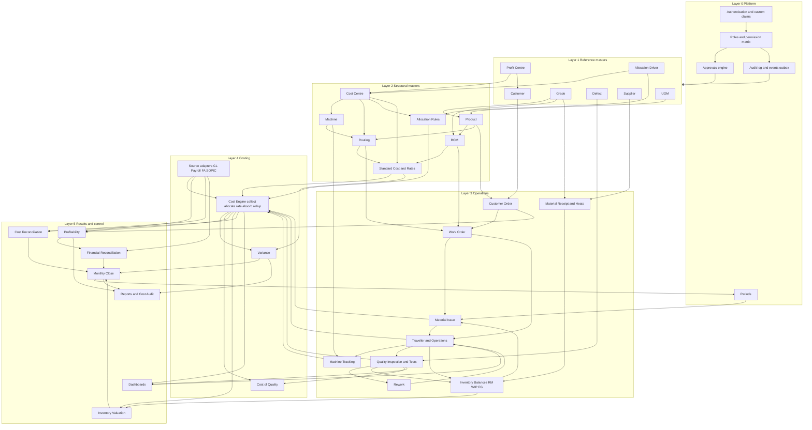

# Deliverable 7 — Module Dependency Map

An arrow `A → B` means **B cannot operate (or cannot be trusted) until A exists with approved data**. The graph decides build order (Deliverable 8) and close order (D+1..D+12).

## 1. Dependency graph



The linear spine you gave is the critical path through this graph:

```
Product Master → BOM → Routing → Work Order → Traveller → Production → Inventory → Cost Engine → Profitability
      ↑            ↑       ↑                       ↑                          ↑
    Grade/UOM    Grade   CC + Machine          Quality + Rework         Source adapters (GL, Payroll, SOPIC)
```

## 2. Dependency table

| Module | Hard dependencies (must exist, approved) | Soft dependencies (optional / degrade gracefully) | Provides to |
|---|---|---|---|
| Auth & Roles | Firebase Auth, custom claims Function | — | everything |
| Approvals engine | Roles, audit log | Notifications | all versioned masters, WO, issues, cost runs, close |
| Periods | Roles | — | every posting (PER-01), close |
| UOM, Grade | Roles | — | Product, BOM, Receipt |
| Profit Centre | Roles | — | Cost Centre, Customer, Profitability |
| Allocation Driver | Roles | — | Cost Centre, Allocation Rules |
| Cost Centre | PC, Driver | Imports (127-row master) | Machine, Routing, Rates, Allocation |
| Machine | Cost Centre | Meters | Routing, Machine Tracking, MHR |
| Product | Grade, UOM | — | BOM, Routing, Customer Order |
| BOM | Product, Grade | — | WO requirements, Standard Cost |
| Routing | Product, CC, Machine | Defect (inspection gates) | WO → Traveller operations, Standard Cost |
| Standard Cost & Rates | BOM, Routing, CC | prior actual runs (to propose rates) | Variance, quotation |
| Allocation Rules | CC, Driver | — | Cost Engine |
| Customer / Customer Order | Customer, Product, PC | ERP order import | WO, Profitability |
| Material Receipt / Heats | Supplier, Grade | Incoming QA | Inventory, Issue |
| Work Order | Customer Order (or stock order), Product, approved BOM + Routing | — | Issue, Traveller |
| Material Issue | WO, Inventory, open Period | Excess approval | Traveller input, Cost Engine (material) |
| Traveller & Operations | WO (Released), Issue | Machine Tracking | Quality, Inventory (WIP / FG), Cost Engine |
| Quality & Rework | Traveller, Defect | Tests (Hydro / ECT / DPT) | WO-03 clearance, Scrap, CoQ |
| Inventory balances | Ledger postings from Receipt / Issue / Ops / QA | — | Valuation, reconciliation |
| Source adapters | Integration decision D-16 | manual imports as fallback | Cost Engine pools, SOPIC |
| Cost Engine | Travellers, Issues, Rates, Allocation Rules, Source adapters | Machine logs (else op hours only) | Variance, Valuation, Profitability, CoQ |
| Variance | Cost Engine, Standard Cost | — | Reports, Close D+10 / D+12 |
| Profitability | Finalized run, Customer Orders, SOPIC | Admin % on sales policy | Reports, PC bridge |
| Inventory Valuation | Cost Engine, Inventory | NRV data | Close D+9, Financial reconciliation |
| Financial Reconciliation | SOPIC, ledger, PC results | — | Close D+11 |
| Monthly Close | all of Layer 5 | — | Period lock, Cost Audit reports |
| Reports / Cost Audit | Finalized runs, Close | — | Management, auditors |

## 3. Close-time dependency (D+1..D+12 → modules)

| Close step (`CLOSE_STEPS`) | Module output required | Blocks |
|---|---|---|
| D+1–D+2 data freeze | Travellers, issues, receipts, sales cut-off | everything below |
| D+3 RM + heat / bar reconciliation | Inventory (Heat / Bar tracking, Stock Reconciliation) | material cost |
| D+4 production + yield reconciliation | Travellers, Quality | yield variance |
| D+5 machine utilization | Machine Tracking | MHR, capacity variance |
| D+6 payroll allocation | Payroll adapter | labour rates |
| D+7 utilities / maintenance / consumables | Meters, maintenance adapter | conversion pools |
| D+8 service CC allocation | Allocation Rules → engine gate | rates |
| D+9 WIP valuation + ageing | Cost Engine → Inventory Valuation | FG / WIP balance |
| D+10 product / order profitability | Finalized run → Profitability | margin report |
| D+11 SOPIC + PC + product-account reconciliation | Financial Reconciliation | close sign-off |
| D+12 management review | Variance closure, exceptions | **period lock** |

## 4. Circular-dependency checks

| Apparent cycle | Resolution |
|---|---|
| Rework → Traveller → Quality → Rework | Rework inserts **new** ops on the traveller; the traveller machine (Deliverable 5) moves forward only, so there is no loop at record level |
| Standard cost ← actual runs ← standard cost | Standards are proposed from a **finalized** prior-period run and approved as a new version. The current run reads only approved versions |
| Close → Period lock → postings → Close | Lock happens after D+12; corrections after lock go through `period.reopen` approval (PER-01) |
