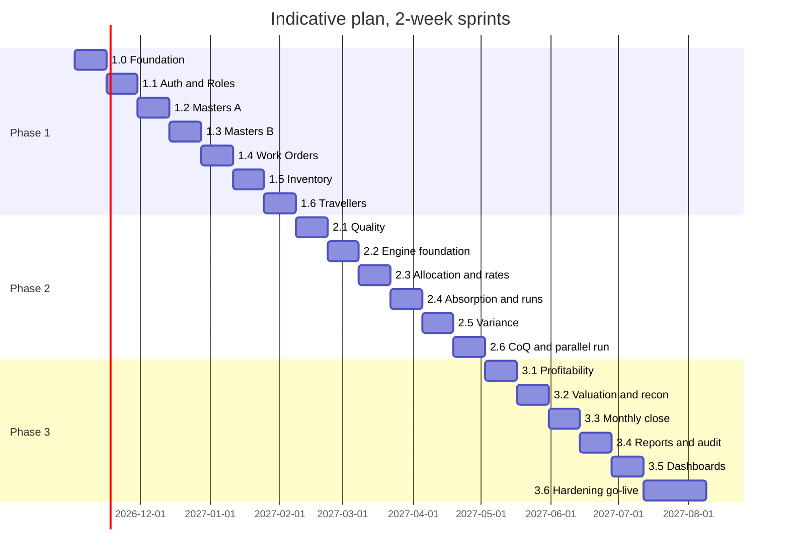

# Deliverable 8 — Implementation Roadmap & Migration Path

## 1. Starting point (verified in the repo)

| Asset | State | Keep / change |
|---|---|---|
| 19 app + 4 auth screens | Render on in-memory mocks (`demoDb`, `manual.ts`, `sample.ts`) | Keep; switch the data source per module |
| `src/domain` (state machines, rules register, services) + 36 passing tests | Pure, deterministic, not used by Functions | Keep; **share with Functions**; extend |
| `src/lib` (costing math, validation, reconciliation, ledger, close, imports) | Real and tested | Keep as primitives |
| `firebase/functions` (3 callables) | Not deployed; wrong paths (F-1) | Rewrite onto shared domain + path helper |
| `firebase/firestore.rules` | Plant-wide read, no per-collection rules | Rewrite from the permission matrix |
| `firebase.json` emulator ports | Configured | Use for all development and tests |
| Nav registry (`modules.ts`) | Flat, role arrays | Restructure to module → screens + permission keys |
| Auth | Demo bypass, no auth listener, no guard from claims | Replace |

**Environment blocker to fix first:** `npm install` currently fails with `EACCES`. Root-owned files exist in `~/.npm` and in `node_modules`. This blocks adding any dependency (e.g. `@firebase/rules-unit-testing`). Fix it on the dev machine with `sudo chown -R $(id -u):$(id -g) ~/.npm "<project>/node_modules"`, or by reinstalling `node_modules` as the normal user. I have not run this.

## 2. Migration strategy

1. **Strangler pattern, module by module.** Every screen reads through a repository interface. `EXPO_PUBLIC_DATA_SOURCE=demo|firestore` selects the implementation, so the demo build keeps working while modules move one at a time.
2. **Domain first.** Each feature starts as a pure service + unit tests in `src/domain`, then gets a Function wrapper, then rules, then the screen switch.
3. **One permission matrix** (`src/config/permissions.ts`) drives nav, the route guard, Functions and rules tests.
4. **Emulator-only until UAT.** No production project writes before Phase 3 go-live.
5. **SAMPLE data stays labelled.** Seeds come from `manual.ts` / `sample.ts` and keep the `SAMPLE` prefix until the client supplies the real masters (D-03).

### Target layering

```
app/ screens ──► hooks (useWorkOrders…) ──► repositories (interface)
                                              ├── demo   (current demoDb, kept for review builds)
                                              └── firestore (reads via SDK; writes via callable Functions)
firebase/functions ──► shared domain (src/domain) ──► Firestore Admin SDK (transactions)
firestore.rules  ◄── generated / tested from src/config/permissions.ts
```

### Definition of done (every module)

- [ ] Domain service + state machine + unit tests (Vitest)
- [ ] Callable Function(s) using the shared domain, with audit + event in the same transaction
- [ ] Firestore rules + rules unit tests (emulator) for every persona in the matrix
- [ ] Composite indexes added to `firestore.indexes.json`
- [ ] Firestore repository + hook; the screen no longer imports `demoDb` / `manual.ts`
- [ ] Permission keys registered; nav and route guard verified per persona
- [ ] Approval kinds wired (if any)
- [ ] Rules register (`rules.ts`) updated; any `NeedsClientDecision` item is visible in the UI copy as pending

---

## 3. Phase 1 — Foundation, Masters, Auth, Roles, Work Orders, Travellers, Inventory

| Sprint | Scope | Repo changes | Exit criteria |
|---|---|---|---|
| **1.0 Foundation** | Repository layer, shared domain, path helper, emulator seeds, permission matrix, CI | `src/data/repositories/*`, `src/config/permissions.ts`, `firebase/functions` tsconfig to include `src/domain`, `firebase/functions/src/paths.ts`, `firestore.indexes.json`, seed script, fix F-1…F-6 | typecheck + lint + vitest + functions build + rules tests green in CI; demo mode unchanged |
| **1.1 Auth & Roles** | AUTH-01..04, SUP-03 | Auth listener in `app/_layout.tsx`, guard in `(app)/_layout.tsx` from claims, Function `setUserAccess`, `forgot-password.tsx`, `admin/users`. Remove demo bypass and role switcher (keep them behind `demo` mode only) | Each of the 7 personas sees exactly its matrix screens on the emulator. Privileged role grant needs a second admin |
| **1.2 Masters A + versioning engine** | UOM, Grade, PC, Driver, CC (import the 127 rows via existing `previewCostCentres`), Defect. Generic master version + approval flow | `src/domain/masters.ts` (MASTER_VERSION_MACHINE), Functions `saveMasterDraft` / `submitMasterVersion`, `approvals` kinds | CC import → validate (`/^8204/`) → approve → effective; edits create new versions |
| **1.3 Masters B** | Product, Customer, Supplier, Machine, BOM, Routing (seed HF 12 / CF 9 / U-Bend ops from `manual.ts` as SAMPLE) | split `engineering.tsx` into `masters/*` routes | BOM + routing approved and effective-dated; where-used query works |
| **1.4 Work Orders** | Customer order (minimal), PRD-01/02/03, WO_MACHINE + `Approved` / `Cancelled` states (D-05) | `types.ts`, `machines.ts`, `phase3.test.ts` updated; Functions `createWorkOrder`, `transitionWorkOrder`; merge `planning.tsx` into the WO lifecycle | WO Draft → Approved (maker ≠ checker) → Released blocked until WO-01 |
| **1.5 Inventory** | INV-01..08: receipts, heats, bars, reservations, issues (excess approval), balances, stock reconciliation | extend `postLedgerTxn` (plant path, PER-01, integer grams, `scrap` type), `postReceipt`, `postMaterialIssue`, `reserveMaterial`; split `inventory.tsx` | Idempotent replay, negative-stock block and locked-period block proven by tests; heat genealogy end to end |
| **1.6 Travellers & Production** | PRD-04..08: traveller generation on release, Production Entry, machine & operation tracking | `TRAVELLER_MACHINE`, `recordOperation` (mass balance, D-06 tolerance → supervisor approval), `machineLogs` | A WO runs Released → InProgress with WIP txns per op on the emulator |

**Phase 1 exit:** on the emulator, a customer order line becomes a WO and goes through approval, release, issue and operations. Inventory and heat genealogy are correct, every action is audited, and no Phase-1 screen reads demo data in `firestore` mode.

**Decisions needed before Phase 1:** D-01 roles, D-02 plant scope, D-03 CC / PC master, D-04 routes, D-05 WO lifecycle, D-06 thresholds, D-07 traceability depth, D-08 ledger / reversal, INV-02 negative stock, D-14 lock owners.

---

## 4. Phase 2 — Quality, Cost Engine, Allocations, Variance

| Sprint | Scope | Repo changes | Exit criteria |
|---|---|---|---|
| **2.1 Quality** | QUA-01..06: inspections, Hydro / ECT / DPT, dispositions, rework ops, two-person release | `recordInspection`, `releaseQuality`, `createRework`; split `quality.tsx` | WO-03 enforced; Reject posts scrap; WO Completed → FG txn |
| **2.2 Engine foundation** | Element catalogue, snapshot + inputsHash, collection, source adapters in **import mode** (GL, payroll, FA, meters, SOPIC) | `src/domain/costing/{types,elements,snapshot,collect}.ts`, `functions/costing/adapters/*`, CST-01 Standard Cost Setup | Unmapped GL accounts block the run; snapshot hash is reproducible |
| **2.3 Allocation + rates** | CST-04 allocation rules, step-down, largest-remainder, §15.3 gate, MHR / LR / UR / OHR, abnormal idle | `allocate.ts`, `rates.ts` (reusing `machineHourRate`) | Gate = 0 to the paise on test data; the demo ₹250 imbalance case fails as expected |
| **2.4 Absorption, rollup, run lifecycle** | CST-02 / 03 / 05, WIP / FG valuation inputs | `absorb.ts`, `rollup.ts`, `run.ts`, Functions `runCostCalculation`, `transitionCosting`; split `costing.tsx` | Run Draft → Finalized with maker-checker; recalculation creates lineage; reproducibility test passes |
| **2.5 Variance** | VAR-01..07, bridge identity check, Annex D investigations | `variance.ts`; investigation workflow + `variance.closure` approval | Σ variances = std cost of actual output − actual cost (exact) |
| **2.6 Cost of Quality** | QUA-07, CoQ snapshots (CAS-21) | engine output → `coqSnapshots` | 4-class CoQ reconciles to quality-tagged pool amounts |

**Phase 2 exit (go / no-go gate):** a **parallel run** for one closed month of real Mehsana data against the current costing (Excel / manual) is reconciled within the materiality tolerance agreed with Finance. Every difference must be explained.

**Decisions needed before Phase 2:** D-09 scrap / rework, D-10 formulas, D-11 UOM / rounding (COST-03), D-12 rate authority, D-16 ERP live vs import, D-17 payroll scope, inventory valuation method (heat-specific vs weighted average), admin %-on-sales policy, materiality tolerance.

---

## 5. Phase 3 — Profitability, Monthly Close, Audit, Reports

| Sprint | Scope | Repo changes | Exit criteria |
|---|---|---|---|
| **3.1 Profitability** | PRF-01..04 from finalized runs + SOPIC NSR | `profitability.ts`; trigger on `costing.finalized`; Quotation tab → order profitability | Order contribution waterfall ties to run totals |
| **3.2 Valuation & reconciliation** | FIN-01..03: inventory valuation, cost reconciliation (UOA), §18 6-layer bridge using existing `reconcileSopic` / `pcBridge` + `RECON_MACHINE` | `runReconciliation`, `transitionRecon`; split `finance.tsx` | Invoice-0 and PC exceptions flow through recon states; bridge balances |
| **3.3 Monthly close** | FIN-04, SUP-05: D+1..D+12 sign-offs, Annex B 18 checks, lock / reopen | `signCloseStep`, `lockPeriod` (gated on all steps), `requestReopen` (approval) | Posting into a locked period is blocked everywhere (PER-01) |
| **3.4 Reports & cost audit** | RPT-01..06, CRA-1, exports | `generateReport` → Cloud Storage (CSV / XLSX / PDF); keep `ExportButton` for small client-side CSV | All Annex A / D / G outputs generated from finalized data |
| **3.5 Dashboards** | DSH-01..05 from `kpiSnapshots` | scheduled `computeKpis`; `overview.tsx` → `dashboard/index` | Dashboard values equal report values for the same period |
| **3.6 Hardening & go-live** | Performance, backups, retention (D-18), offline queue for Production Entry (D-19), security review, UAT journeys, data migration | migration scripts: opening heats / RM, open WIP, FG, approved standards, open WOs. Retire `review.tsx` and demo mode from the production build | UAT sign-off; first live month closed in the system with a parallel check |

**Decisions needed before Phase 3:** D-13 reconciliation rules + D+ calendar binding, D-15 report list, D-18 audit retention, D-19 offline scope.

---

## 6. Existing screen → migration action

| Existing file | Phase / sprint | Action |
|---|---|---|
| `sign-in.tsx` | 1.1 | Keep. Remove demo accounts in production mode. Add auth listener + plant selection |
| `profile.tsx` | 1.1 | Keep. Role switcher only in demo mode |
| `admin.tsx` | 1.1 / 3.3 | Split into `admin/users`, `admin/audit-log`, `admin/periods`, `admin/policies` |
| `cost-centres.tsx`, `profit-centres.tsx` | 1.2 | Move to `masters/*`; add profit-centres to the registry |
| `imports.tsx`, `integrations.tsx` | 1.2 / 2.2 | Move to `admin/*`; become the import-mode adapters' UI |
| `engineering.tsx` | 1.3 / 2.2 | Split into masters (routings, boms, machines, products) + `costing/standards` |
| `planning.tsx` | 1.4 | Merge into the WO lifecycle (create / approve / release) |
| `work-orders.tsx` | 1.4 / 1.6 | Split into WO list / detail, travellers, production entry |
| `inventory.tsx` | 1.5 | Split into rm / wip / fg / heats / reconciliation |
| `quality.tsx` | 2.1 / 2.6 | Split into inspections / tests / rework / defects / coq |
| `costing.tsx` | 2.2 – 2.5 / 3.1 | Split into runs / rollup / allocation-rules / log; Quotation → profitability/order |
| `approvals.tsx`, `exceptions.tsx`, `notifications.tsx` | 1.2 onward | Keep; switch to the Firestore repository as approval kinds go live |
| `finance.tsx` | 3.2 / 3.3 | Split into finance/* |
| `reports.tsx` | 3.4 | Split into reports/* |
| `overview.tsx` | 3.5 | Becomes `dashboard/index` from `kpiSnapshots` |
| `review.tsx` | 3.6 | Remove from the production build |

## 7. Indicative timeline

Two-week sprints with a team of roughly 3 developers, 1 QA and 1 business analyst / costing SME. This is **indicative** and will change once the D-xx answers are known.



That is about 20 sprints (≈ 40 weeks) to go-live. The critical-path risks are the D-10 formula sign-off (Phase 2 entry) and the D-16 ERP integration choice (adapters).

## 8. Key risks

| Risk | Mitigation |
|---|---|
| Formulas not signed off (D-10) | Engine stages are isolated pure functions; formulas are swappable per `policyVersion` without schema change |
| Master data quality (127 CCs with blank departments, missing CCs for Open Annealing / SR Furnace) | Phase 1.2 import validates and blocks; exceptions are routed to owners (existing `CC_EXCEPTIONS`) |
| ERP / SOPIC access late (D-16) | Import-mode adapters first; live API later behind the same adapter interface |
| Functions and rules have never run | Sprint 1.0 makes rules tests + emulator CI mandatory before any module |
| Local `npm` permission errors | Fix ownership before Sprint 1.0 (see §1) |
| Shop-floor connectivity | Production Entry is the only offline candidate (D-19); queue + idempotency key already supported by INV-01 |
