# Demo Experience — The 14-Step Guided Journey

The prototype must simulate the complete business journey end to end. This is the **golden path** the consultant walks the client through. It reuses the existing journeys hub (`review.tsx`) pattern — a guided checklist that deep-links into each module and tracks progress — extended to the 14 costing steps.

## 1. Journey orchestration (how it runs)

- A **Guided Journey** panel (extend the existing `review.tsx` journeys card) lists the 14 steps as a `Stepper` + checklist. Each step: title, the module it opens, a one-line "what to show", and a "Mark done" control. A `ProgressRing` tracks N/14.
- Each step **deep-links** to the real module route and pre-selects the demo record created by the previous step, so the data visibly flows forward. All on deterministic demo data (`mocks/*`, `data/sample.ts`), resettable with `resetDemo()`.
- A persistent **"Demo journey" affordance** (a `Button` in the header or a floating "Next step" control) lets the presenter advance without hunting through the nav.
- Every screen already carries the `DemoBanner`, so the client always knows it's sample data.

## 2. The 14 steps

| # | Step | Module (route) | What the client does / sees | Output that feeds the next step |
|---|---|---|---|---|
| 1 | Create Product | Product Master `/(app)/masters/products` | Clone `SAMPLE-TUBE-304-50` → new product, save | Product available to BOM & Routing |
| 2 | Create BOM | BOM `/(app)/masters/boms` | Add RM / consumable / packaging lines; watch Live Cost Impact; save v1 | Material cost/kg |
| 3 | Create Routing | Routing `/(app)/masters/routings` | Build HF route (Circular Saw → … → Packing); set hrs/yield per node | Std machine/labour hrs, cumulative yield |
| 4 | Run Standard Cost | Standard Cost Simulator `/(app)/costing/standards` | Pick product+route+qty → cost waterfall → **Std cost ₹616/kg**; save standard | Standard cost baseline |
| 5 | Create Work Order | Work Orders `/(app)/production/work-orders` | Wizard: product+qty → assign BOM → assign routing → create WO-2026-0314 | A released-ready WO |
| 6 | Capture Production | Production Data Capture `/(app)/production/entry` | Record output / scrap / machine / labour / consumption | Actuals for costing |
| 7 | Track Traveller | Traveller `/(app)/production/travellers` | Open T-0314-07 timeline; advance a stage | Execution state, heat/machine/operator |
| 8 | Calculate WIP | WIP Valuation `/(app)/inventory/wip` | View pipeline RM→…→FG with qty/cost/yield/ageing | WIP value |
| 9 | Run Allocations | Allocation Engine `/(app)/costing/allocation-rules` | Change a driver → Recalculate → see impact; gate = 0 | Allocated conversion cost |
| 10 | View Variance | Variance `/(app)/variance` | Interactive bridge Std→…→Actual; drill a variance | Variance explanation |
| 11 | Product Profitability | `/(app)/profitability/product` | Grid/Chart/Heatmap; open margin breakdown | Product margin |
| 12 | Customer Profitability | `/(app)/profitability/customer` | Interactive margin waterfall for "Nordic Energy AB" | Customer margin |
| 13 | Close Month | Monthly Cost Close `/(app)/finance/close` | Work the 9-step checklist; lock the month | Locked period, cost pack |
| 14 | Executive Dashboard | `/(app)/dashboard` | See the whole month reflected: cost, margin, yield, close health | The story lands |

## 3. Journey flow diagram

```mermaid
flowchart LR
    S1["1 Product"] --> S2["2 BOM"] --> S3["3 Routing"] --> S4["4 Standard Cost"]
    S4 --> S5["5 Work Order"] --> S6["6 Production"] --> S7["7 Traveller"] --> S8["8 WIP"]
    S8 --> S9["9 Allocations"] --> S10["10 Variance"] --> S11["11 Product Profit"]
    S11 --> S12["12 Customer Profit"] --> S13["13 Close Month"] --> S14["14 Executive Dashboard"]
    S14 -.drill back.-> S1
```

## 4. Components for the journey hub

`AppShell`, `PageHeader`, `Stepper` (14 steps), `ProgressRing` (N/14), journey `Card`s (title + "open" + "mark done" — the existing `review.tsx` flow pattern), `Button` ("Start journey" / "Next step"), `StatusChip`, `DemoBanner`, `Toast`, `FeatureHelp`.

## 5. UX recommendations for the demo

- **One click per step.** "Next step" opens the right route and scrolls to the relevant element; the presenter never searches the nav.
- **Carry one record through.** The product from step 1 is the subject of every later step, so the client sees cause → effect (BOM cost → standard cost → WO → actuals → variance → margin).
- **Show the recalc moments.** Steps 2 (live BOM impact), 4 (waterfall), 9 (allocation impact), 10 (variance bridge) are the interactive "it's really calculating" beats — rehearse these.
- **Reset between demos.** A "Reset demo" control (`resetDemo()`) restores the starting data so each client session is clean.
- **Progress is visible.** The `ProgressRing` and done-chips make the 14-step arc tangible; ending on the Executive Dashboard ties every earlier number to the management view.

## 6. Mobile responsiveness

- The journey hub works on tablet for a walk-the-floor demo: steps stack as cards, `ProgressRing` on top, "Next step" pinned to the bottom.
- Every destination module is already responsive per its blueprint; shop-floor steps (6, 7) are the most touch-optimised.

## 7. What is simulated vs real

| Aspect | In the demo |
|---|---|
| Data | Deterministic sample data from `mocks/*` / `sample.ts`; no backend writes |
| Calculations | Real `lib/costing` / `domain` math (MHR, MPV/MUV, yield, allocation gate) on sample inputs |
| Approvals / lifecycle | Real state machines (`WO_MACHINE`, `COSTING_MACHINE`) enforced client-side for the demo |
| Persistence | In-memory; `resetDemo()` restores | 
| Export | Real CSV (web) via `ExportButton` |

This is a faithful **working prototype**: the flows, gates and numbers behave like the real system, on sample data, with nothing written to a production backend — matching the demo-experience requirement.
