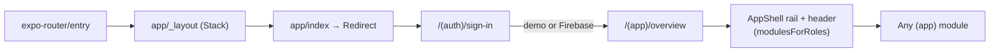
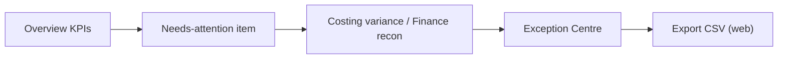
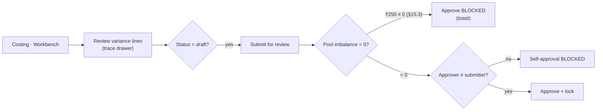
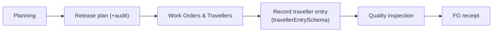
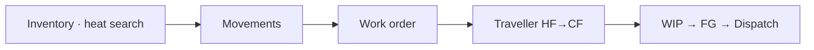
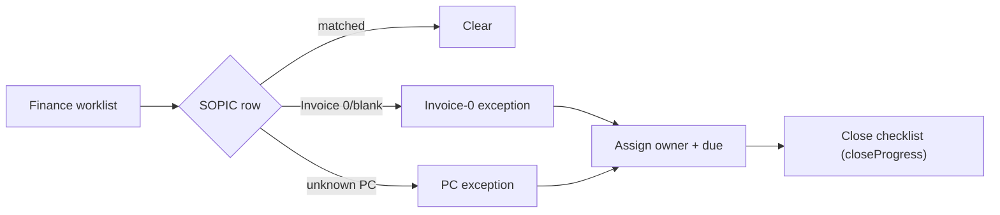
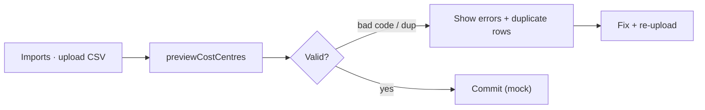
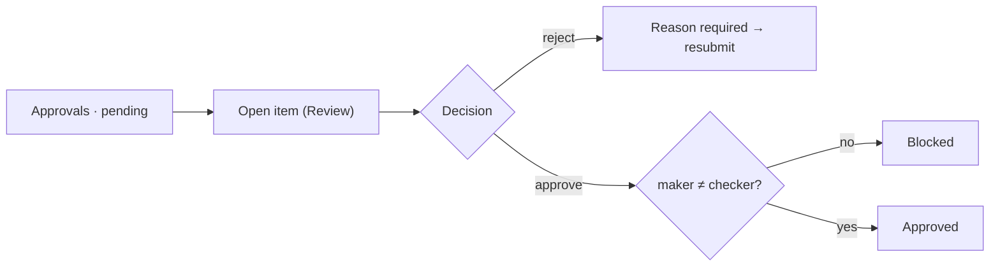
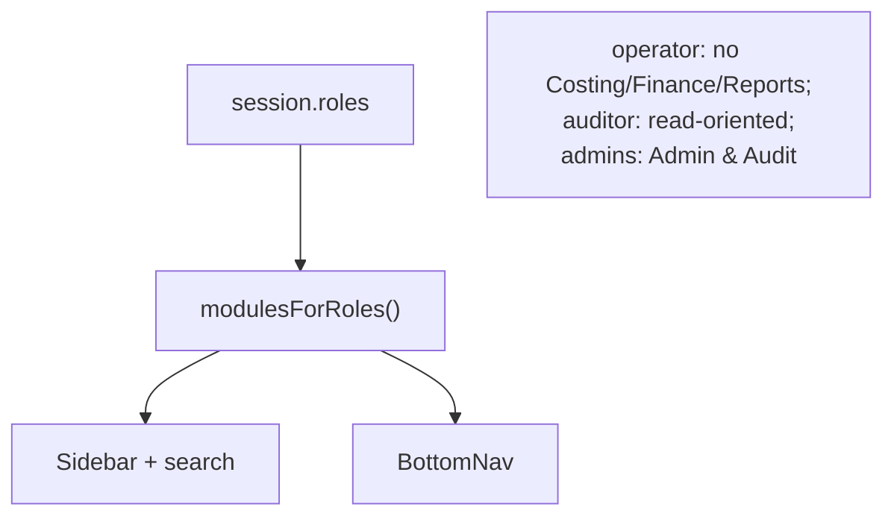

# Workflow Mapping — Alleima Cost Intelligence

_Phase 4 deliverable. Maps the major cross-screen user journeys grounded in the current code. Diagrams use Mermaid. No new business rules are invented._

## Navigation model

Chrome is provided per-screen by `AppShell`; navigation targets come from the single `modules.ts` registry, filtered by role.

## Journey A — Management overview → exception

Roles: management/auditor. Data: `reconcileSopic`, `KPI_TRIGGERS`. Reversible: read-only until export.

## Journey B — Costing calculation & maker-checker approval

Logic: `machineHourRate/MPV/MUV/yieldPct` (real); maker-checker mirrors `canApprove` semantics (currently inline). Reversible: demo state resets via admin.

## Journey C — Work-order lifecycle

Roles: prodMgr/supervisor/operator/quality. Validation: `travellerEntrySchema`, `validateLedgerIntent`.

## Journey D — Material traceability

Mirrors the `TraceabilityTimeline` steps in `costing.tsx`.

## Journey E — Finance reconciliation & close

Logic: `reconcileSopic` (matched / invoiceZero / pcExceptions), `isPlaceholderInvoice`, `closeProgress`, `CLOSE_STEPS`.

## Journey F — Master-data import

Logic: `previewCostCentres` (code `/^8204/`, duplicate detection), `costCentreSchema`.

## Journey G — Approvals queue

## Role → workspace visibility

## Reversibility note (safety)

All journeys operate on in-memory mocks; mutations reset via `resetDemo()`/`resetAudit()` in Admin. No production records are touched. Real writes are explicitly out of scope until the production phase and client sign-off.
